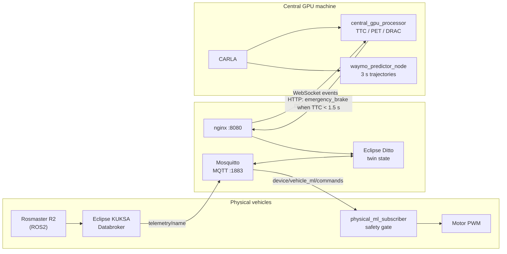

<div align="center">

# Smart Digital Twin of an Urban Intersection

**Real robotic vehicles in a lab, mirrored live in a CARLA simulation, to make intersection safety analysis possible at small scale.**


[Overview](#overview) · [How it works](#how-it-works) · [Run it](#run-it) · [Targets](#engineering-targets) · [Roadmap](#roadmap) · [Troubleshooting](#troubleshooting)

</div>

<!-- TODO (biggest single upgrade): add a screenshot or short GIF of the lab vehicle and the CARLA vehicle moving together, e.g.
<p align="center"></p>
-->

---

## Overview

An intersection is hard to study safely: you can't stage near-collisions on a real road. This project builds a **small-scale digital twin** instead. Robotic vehicles (Rosmaster R2) drive in a controlled lab, and each one has a virtual counterpart in the [CARLA](https://carla.org/) simulator that follows it in real time.

Together they give a shared bird's-eye view, the **SkyEye**, of the whole intersection. That view is the foundation for safety analysis:

| Hazard | What the twin can reveal |
| ------ | ------------------------ |
| Occlusion | What a vehicle cannot see, but the SkyEye can |
| Conflicting trajectories | Paths that will cross at the same time |
| Unsafe proximity | Time-to-collision and headway dropping below thresholds |

> A university capstone research project, built as a small-scale proof of concept. It is not intended for use on public roads.

### Where the project is today

The system is built in four stages. Stage 1 proves the whole data pipeline using **synthetic** vehicle data, so the infrastructure is validated before any hardware is added.

| Stage | Goal | State |
| :---: | ---- | :---: |
| 1 | Synthetic vehicle data validates the communication and digital twin infrastructure | In progress |
| 2 | One physical vehicle (Rosmaster R2) synchronized with CARLA | Planned |
| 3 | Two or more physical vehicles, scripted and repeatable scenarios | Planned |
| 4 | SkyEye view, AI-assisted safety recommendations, Kafka streaming and logging | Planned |

---

## How it works

Every vehicle is described by a **digital twin** (an Eclipse Ditto "thing") that always holds its latest state: position, speed, heading. Anything that can update that state, a real robot or a test script, drives the simulation the same way.



| Thing | Role |
| ----- | ---- |
| `org.example:intersection_01` | The intersection; holds the latest `SafetyMetrics` |
| `org.example:vehicle_ml` | The ML vehicle; the only one with a `SafetyGate` |
| `org.example:human_vehicle` | The human-driven RC car |

The full proposed architecture is in Appendix A (Figure A.1) of the project report.

**Why this design?** The twin layer decouples the vehicles from the simulator: anything that writes the same telemetry, a real robot or a test script, drives everything downstream the same way.

<details>
<summary><b>Technology choices</b></summary>

| Component | Role |
| --------- | ---- |
| ROS2 | Communication between physical vehicles and software components |
| Eclipse KUKSA Databroker | Vehicle signals (gRPC) |
| Eclipse Ditto | Digital representation and current state of each vehicle |
| CARLA | Virtual simulation environment (AWSIM was also evaluated) |
| Apache Kafka | Data streaming, storage and later analysis (planned) |
| Docker | Runs the Ditto stack locally |

</details>

<details>
<summary><b>Repository layout</b></summary>

```
.github/workflows/   CI pipeline
run_simulation.py    Starts everything and runs the left-turn analysis
docker/              Ditto stack: docker-compose.yml, mosquitto.conf, nginx.conf
config/              ditto_policies.json, ditto_entities.json, ditto_connections.json,
                     settings, and the CARLA 0.9.16 Python client (wheel and egg)
models/              ONNX weights and the contract they must meet (see models/README.md)
scripts/
  setup_entities.py           Provisions Ditto from config/
  central_gpu_processor.py    Master tick, overhead LiDAR, state fusion, safety metrics, brake trigger
  waymo_predictor_node.py     History buffer, 3 s trajectory prediction, debug drawing
  physical_ml_subscriber.py   Onboard safety gate (runs on the vehicle)
  left_turn_scenario.py       Safe vs unsafe left turn, and its analysis
  ditto_carla_agent.py        Mirrors one vehicle Thing in CARLA, with a chase camera
  test_carla_connection.py    CARLA connection check
  test_traffic.py             Spawns background traffic in CARLA
tests/               Safety logic unit tests and the end-to-end latency benchmark
bridge/              Standalone Ditto to CARLA synchronization (ditto_carla_sync.py)
hardware/            KUKSA to Ditto publisher (kuksa_to_ditto.py)
requirements.txt     Python dependencies
```

</details>

---

## Quick start

```powershell
python run_simulation.py
```

That one command starts whatever isn't already running (Docker, the Ditto stack, CARLA), provisions the twins, starts the processor, safety subscriber and predictor, runs the safe and unsafe left turn, prints the comparison, then shuts down what it started. Add `--case safe` or `--case unsafe` to run one, and `--leave-running` to keep CARLA and Docker up for faster repeat runs. If CARLA isn't found automatically, pass `--carla-exe` or set `CARLA_EXE`. Logs go to `output/logs/`.

### The left-turn analysis

`vehicle_ml` waits at the stop line to turn left across `human_vehicle`, which comes straight through at 10 m/s without slowing. Both runs use the same paths and speeds and differ only in when the turner goes: the unsafe one pulls out to arrive 0.8 s ahead of the oncoming car, and the safe one waits to arrive 3 s after it.

A run is **UNSAFE** if the vehicle outlines overlap, TTC drops under 1.5 s, PET drops under 1.5 s, DRAC goes over 3.35 m/s2, or the safety brake fires. Each run is shown next to the same plan replayed with no brake, so you can see what the brake changed. The report and per-tick data go to `output/`.

Measured PET is the time between one vehicle leaving a 2.5 m zone around the conflict point and the other entering it. Oncoming traffic never reacts in this scenario.

---

## Run it step by step

By the end, a vehicle on a collision course gets its motors cut before impact.

### Before you begin

- [ ] Windows with **Docker Desktop** (WSL2 backend)
- [ ] **Python 3.10**
- [ ] **CARLA 0.9.16** server installed. Follow the [CARLA quick start installation guide](https://carla.readthedocs.io/en/latest/start_quickstart/) and make sure you download version 0.9.16, because the client in this repo must match the server
- [ ] A GPU capable of running CARLA

All commands run from the repository root in PowerShell or Command Prompt.

### 1. Install the Python dependencies

```powershell
python -m venv .venv
.venv\Scripts\activate
pip install -r requirements.txt
pip install config\carla-0.9.16-cp310-cp310-win_amd64.whl
```

### 2. Spin up the infrastructure

```powershell
docker compose -f docker/docker-compose.yml up -d
```

Wait **60 to 90 seconds** for the services to form a cluster, then check that every container is `Up`:

```powershell
docker ps --format "table {{.Names}}\t{{.Ports}}"
curl.exe http://localhost:8080/api/2/things
```

**You should see:** all containers `Up`, and the `curl` call returning a JSON list.

<details>
<summary><b>What runs on which port</b></summary>

| Port | Service |
| ---- | ------- |
| 8080 | nginx, proxying the Ditto API and WebSocket. It injects the `x-ditto-pre-authenticated` header |
| 8081 | Ditto gateway, direct access |
| 1883 / 9001 | Mosquitto (MQTT / WebSocket) |
| 27017 | MongoDB (data is kept in the `mongo-data` volume) |

> **Warning:** Nothing here authenticates. Anyone who can reach 8080 can write to the twins, and anyone who can reach 1883 can publish telemetry or brake commands. Keep these ports on a trusted lab network.

</details>

### 3. Provision the twin entities

```powershell
python scripts/setup_entities.py
```

**You should see:** each policy, Thing and connection reported with a 2xx status, then `Done`. Re-running this resets the Things to their initial state.

### 4. Start the onboard vehicle listener

On the vehicle's computer (Raspberry Pi or Jetson), which only needs `pip install paho-mqtt`:

```bash
python scripts/physical_ml_subscriber.py --broker <central machine IP>
```

Use `--driver sim` to try it without motors, on any machine.

**You should see:** `MOTORS CUT: waiting for first SafetyGate state`, then `Hold released`.

> The gate holds the motors off until it hears an explicit release, and again whenever it loses the broker. If the Rosmaster's ROS2 driver owns the serial port, this script cannot open it; the stop needs to go through that driver instead.

### 5. Launch the central GPU processor

Start the CARLA server (for example `CarlaUE4.exe` from your CARLA install folder), then:

```powershell
python scripts/central_gpu_processor.py
```

**You should see:** `Master tick running at 10 Hz`, and the CARLA window looking straight down at the intersection. Use `--no-carla` to run the safety engine on Ditto telemetry alone. A cold map load can take several minutes.

This process owns the simulation: it loads `Town01`, enables synchronous mode (`fixed_delta_seconds=0.1`) and drives `world.tick()` in real time. **Start it before the scripts below**, which attach to its world without changing the map or settings. Exit with Ctrl+C so it can restore asynchronous mode and remove its sensors. If it dies uncleanly, the next processor takes over and warns that it did.

Then, each in its own terminal:

```powershell
python scripts/ditto_carla_agent.py
python scripts/ditto_carla_agent.py --thing human_vehicle
python scripts/waymo_predictor_node.py
```

The agents mirror each Thing into a CARLA vehicle named after it, spawned near the intersection. That name is how the processor recognises them, so the brake logic works with no external telemetry at all. The predictor draws each vehicle's next 3 s as red lines that follow the road, using its turn signal or turn rate to choose a branch, and the processor draws yellow boxes (green when they come from a model).

> `scripts/test_traffic.py` ticks the world itself unless you pass `--asynch`, and `scripts/test_carla_connection.py` always does. Two tickers will fight, so stop the processor first, or use `test_traffic.py --asynch` alongside it.

### 6. Run the scenario

Publish telemetry from each vehicle with `hardware/kuksa_to_ditto.py`, then drive the human RC car around the blind corner toward the ML car's path.

**You should see:** `[ALERT] EMERGENCY BRAKE sent` from the processor and `MOTORS CUT` on the vehicle, before impact.

The `vehicle_ml` twin also stops on screen and its window shows `EMERGENCY BRAKE - HOLDING`. `human_vehicle` has no safety gate, so it keeps moving.

The brake **latches**. Once the area is clear, release it (a twin following live poses then jumps back to the feed; one dead reckoning resumes from where it stopped):

```powershell
python scripts/setup_entities.py --clear-brake
```

<details>
<summary><b>Telemetry format</b></summary>

Vehicles publish [Ditto Protocol](https://eclipse.dev/ditto/protocol-overview.html) JSON to `telemetry/<thing name>`. The engine reads `location` + `velocity` (m/s), or `kinematics` as written by `hardware/kuksa_to_ditto.py` (`x`, `y`, `heading` in degrees, `speed` in km/h).

```json
{
  "topic": "org.example/human_vehicle/things/twin/commands/merge",
  "headers": { "content-type": "application/merge-patch+json", "response-required": false },
  "path": "/features",
  "value": {
    "location": { "properties": { "x": 12.0, "y": 4.5, "z": 0.0 } },
    "velocity": { "properties": { "vx": 1.5, "vy": 0.0 } }
  }
}
```

Poses must already be in the CARLA frame. Lab-to-CARLA mapping is still on the roadmap; `TELEMETRY_SCALE` in `central_gpu_processor.py` covers scale only.

</details>

<details>
<summary><b>Known limitations</b></summary>

- **No model weights are in the repo.** Without them, the processor uses CARLA ground truth instead of LiDAR detections, and the predictor follows the road at the vehicle's current speed. Both say so at startup. See [models/README.md](models/README.md), including why a stock CenterPoint is unlikely to work from an overhead sensor.
- **The vehicle can't tell if the processor has died.** The gate fails safe when the broker link drops, but a crashed processor just stops sending hazards. The processor does warn when `vehicle_ml` telemetry goes stale, since it can't protect a vehicle it can't see.
- **PET is predicted**, from current velocities at the path crossing point, because true PET is only known after both actors have passed.
- **The brake's two triggers have different blind spots.** Straight-line TTC under 1.5 s can't see a turn coming. The path check brakes if the predicted paths meet within 3 s, but it holds current speed, so it can't foresee a stop or an unsignalled turn, and it only works with CARLA actors, not model detections or telemetry alone.

</details>

### Shutting down

```powershell
docker compose -f docker/docker-compose.yml down
```

This keeps your Ditto data. Add `-v` only if you want to wipe it.

---

## Testing

```powershell
pytest
```

`tests/test_safety_logic.py` needs nothing running. `tests/test_mqtt_pipeline.py` runs the full telemetry-to-motor-cut path and the latency benchmark against the Docker stack (no CARLA needed). It skips itself when the stack is down, as on CI, and it resets Thing state. Add `-s` to see the timings.

---

## Troubleshooting

<details>
<summary><b>Ditto resets or won't answer on Windows</b></summary>

Use `localhost`, not `127.0.0.1`. Requests to `127.0.0.1:8080` were reset in our setup while `localhost` worked.

</details>

<details>
<summary><b>PATCH requests are rejected</b></summary>

Ditto only accepts `Content-Type: application/merge-patch+json` for PATCH. Plain `application/json` is rejected, so use PUT if you want to send plain JSON.

</details>

<details>
<summary><b>The vehicle appears under the map</b></summary>

The vehicle's height comes from the road surface at the received x/y, not from the published `z`. Check that the published coordinates are on a road in the loaded map (use the spawn points the agent prints).

</details>

<details>
<summary><b>Empty replies or resets after changing the compose file</b></summary>

Run `docker compose -f docker/docker-compose.yml down`, then `up -d`, and wait a minute. Make sure no two services publish the same host port.

</details>

<details>
<summary><b>Ditto data disappeared</b></summary>

`down -v` deletes the `mongo-data` volume. Plain `down` keeps it.

</details>

<details>
<summary><b>CARLA import or connection errors</b></summary>

The client and server versions must match. The wheel in `config/` is for CARLA 0.9.16 and Python 3.10 on Windows.

</details>

---

## Engineering targets

Targets from the project report. They are subject to validation.

| Requirement | Target |
| ----------- | ------ |
| Telemetry payload (REQ-SYS-001) | Structured state vector (x, y, z, speed, heading, yaw rate, trajectory), JSON over MQTT/HTTP |
| End-to-end latency (REQ-SYS-002) | At most 100 ms, from sensor to CARLA rendering |
| Update rate (REQ-SYS-003) | At least 10 Hz (target 20 Hz) |
| Position accuracy (REQ-SYS-004) | Within 5 cm after mapping lab coordinates into CARLA (e.g. 1:10 scale) |
| Heading accuracy (REQ-SYS-005) | Within 2 degrees |
| Bird's-eye rendering (REQ-SYS-006, 007) | At least 30 FPS, at most 100 ms display delay |
| Scalability (REQ-SYS-008, 009) | 10 concurrent vehicles within 150 ms; add vehicles without restarting |
| Logging (REQ-SYS-010) | 10 Hz, UTC timestamps at 1 ms precision |
| Safety metrics (REQ-SYS-011) | Compute time-to-collision and headway; flag events when TTC drops below 1.5 s |

---

## Roadmap

- [ ] Connect a physical Rosmaster R2 through ROS2 and KUKSA
- [ ] Coordinate-frame mapping from the lab room to CARLA world space
- [ ] Multi-vehicle support and scripted scenarios (straight, turn, stop, speed change, set routes)
- [ ] SkyEye bird's-eye view
- [x] Safety metrics (TTC, PET, DRAC) and an emergency brake trigger
- [ ] Trained detection and trajectory models in `models/`
- [ ] AI-assisted recommendation component (warnings, slow down, re-plan)
- [ ] Kafka streaming and a local database for logging
- [ ] Extend CI/CD beyond the current pipeline

---

### Acknowledgements

Built on [CARLA](https://carla.org/), [Eclipse Ditto](https://eclipse.dev/ditto/), [Eclipse KUKSA](https://eclipse.dev/kuksa/), and [ROS2](https://docs.ros.org/).
