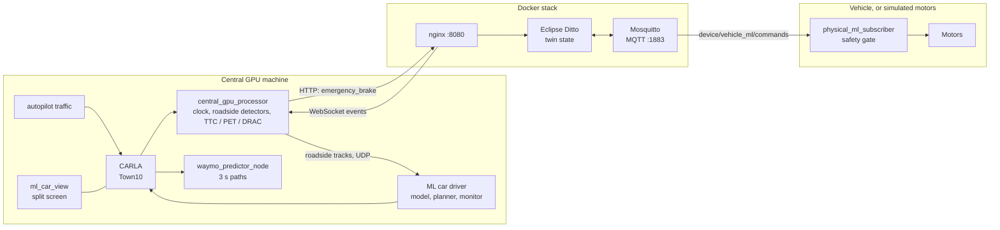
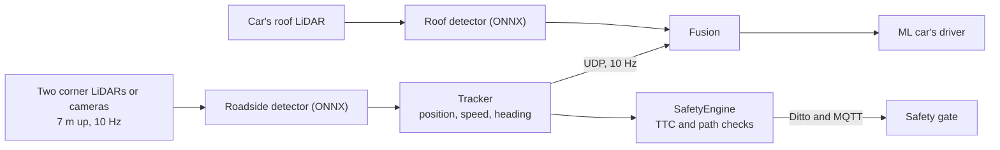
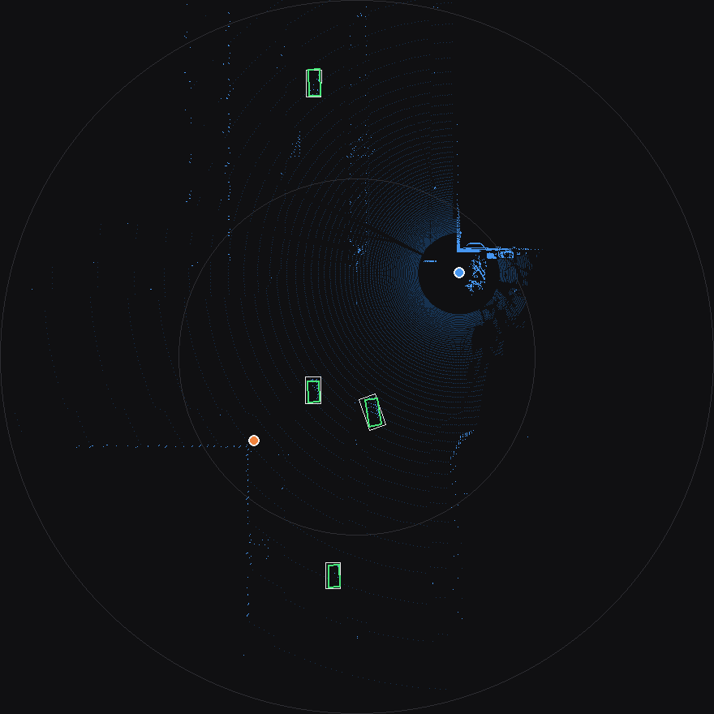
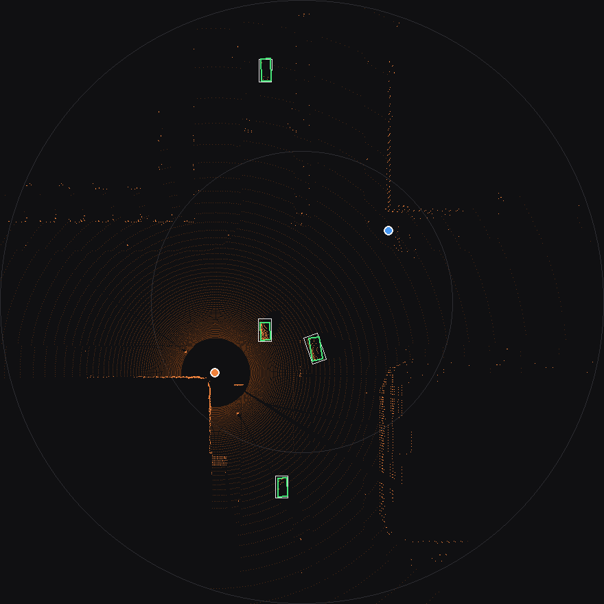

<div align="center">

# Smart Digital Twin of an Urban Intersection

**A CARLA and Eclipse Ditto simulation where a trained model drives a car through an intersection, seeing it through trained detectors on the car and at the roadside, while a separate safety system watches from above.**


*An early scripted run of the safety brake: it stops the magenta ML car 0.21 m from an oncoming car, which passes, and then the car finishes its turn.*

[What it does](#what-it-does) · [Run it](#run-it) · [How it works](#how-it-works) · [Results](#results) · [Train and reproduce](#train-and-reproduce) · [Status](#project-status) · [Limitations](#known-limitations) · [Testing](#testing)

</div>

---

## What it does

You can't stage near-collisions on a real road, so this project studies them in a digital twin of an intersection. It's a university capstone research project and a proof of concept, not for use on public roads.

The magenta **ML car** drives through `Town10_Intersection_01` in CARLA's Town10. A trained model chooses its steering and target speed, and a fixed PID controller works the pedals. The other cars are CARLA's autopilot, and the hazards are scripted. Around that, the system:

- **Perceives with trained detectors,** as a real car would. The ML car has its own roof LiDAR, and a roadside unit at the junction adds either two corner LiDARs or two cameras. The project compares [three such configs](#perception-configs).
- **Drives defensively.** A [planner and the car's own safety monitor](#how-the-ml-car-drives) can slow the model down when what it perceives calls for it.
- **Predicts each vehicle's next 3 seconds.** The ML car uses a [model trained on Waymo data](#trajectory-model) (the magenta line), and the other cars follow the road (the red lines).
- **Scores the risk** with surrogate safety metrics: time-to-collision (TTC), post-encroachment time (PET) and deceleration rate to avoid a crash (DRAC).
- **Keeps a safety gate** on the roadside unit's view. It sends brake commands through Ditto and MQTT to a gate that cuts a real vehicle's motors. In the simulation the gate's decisions are recorded but don't hold the car, so each config is judged on its own driving.
- **Follows the ML car** in a split-screen window, in first and third person, showing the model's live inputs and outputs, the safety checks, recent events, and who's in control. Each config also opens a window of what its sensors see.
- **Measures every run** from CARLA's true positions, so the configs are scored the same way, over [hundreds of seeded situations](#defensive-driving-bench).

<p align="center"></p>

*The ML car's window during a left turn. It's waiting inside the junction: the next car reaches its route in 2.8 s, so the model asks for almost no speed.*

The ML car has a magenta box and predicted path, and other cars have yellow boxes and red paths.

---

## Run it

### You'll need

- Windows with **Docker Desktop** (WSL2 backend)
- **Python 3.10**
- **CARLA 0.9.16** and a GPU that can run it. The client and server versions must match; see the [CARLA install guide](https://carla.readthedocs.io/en/latest/start_quickstart/)
- **Trained models,** which aren't in the repository: the driving model `models/driving_policy.onnx`, and for the configs, the detectors `roof_detector.candidate.onnx`, `rsu_detector.candidate.onnx` and `rsu_camera_detector.candidate.onnx`. See [Train and reproduce](#train-and-reproduce). The ML car has no driver without its model, so the launcher refuses to run

### Install

```powershell
python -m venv .venv
.venv\Scripts\activate
pip install -r requirements.txt
pip install config\carla-0.9.16-cp310-cp310-win_amd64.whl
```

The detectors run on the GPU when `onnxruntime-gpu` with cuDNN 9 is installed, and on the CPU otherwise.

### Start everything with one command

```powershell
python run_simulation.py
```

This starts whatever isn't already running (Docker, the Ditto stack, CARLA), runs the three hazard scenarios on each of the three configs in turn with 15 background cars, writes the results, then shuts down only what it started. It starts and stops the processor once per config, and opens the ML car's window and that config's sensor window. A first CARLA launch can take several minutes.

**Only run one copy at a time.** A second one on the same CARLA disturbs the first, because it re-provisions the twins and changes the world's settings.

| Scenario | What happens | Passes with |
| -------- | ------------ | ----------- |
| `left_turn` | The ML car turns left across oncoming traffic | The turn finished with no collision |
| `red_light_runner` | A speeding car, hidden behind a truck, runs its red light across the ML car's path | No collision, and the car stopped in time |
| `hidden_pedestrian` | A person steps out from behind stacked shipping containers | No collision |

```powershell
python run_simulation.py --planner                  # the same, with the planner choosing the ML car's speed
python run_simulation.py --lidar_only               # one config
python run_simulation.py --camera_and_rsu --scenario hidden_pedestrian
python run_simulation.py --lidar_and_rsu --scenario all    # every scenario, the five tests included, on one config
python run_simulation.py --run_study_matrix --traffic 0 15 --repeat 5   # the whole comparative study, for hours
python run_simulation.py --free-drive               # normal driving in traffic, on CARLA's true positions
```

| Option | What it does |
| ------ | ------------ |
| `--lidar_and_rsu`, `--camera_and_rsu`, `--lidar_only` | Runs only that [config](#perception-configs) |
| `--scenario ...` | Runs these by name instead: the three above, the five tests (`traffic_light`, `left_turn`, `blind_corner`, `cut_in`, `yellow_light`), `oncoming_turner` or `clear_road`, or `all` |
| `--planner` | The [planner](#how-the-ml-car-drives) chooses the ML car's speed. Only with the default run or `--run_study_matrix` |
| `--run_study_matrix` | Every scenario on every config, at each `--traffic` load, `--repeat` times |
| `--traffic 0 15`, `--repeat 5` | Background cars, and runs of each scenario |
| `--free-drive` | Normal driving in traffic instead. `--seconds` sets how long (300 simulated seconds by default, 0 until Ctrl+C), and `--traffic` and `--walkers` the traffic (15 and 8) |
| `--quiet` | Leaves out the live table of values |
| `--no-view` | Doesn't open the windows, which is quicker |
| `--seed 1` | Spawns traffic the same way each run |
| `--leave-running` | Keeps CARLA and Docker up, for faster repeat runs |
| `--carla-exe <path>` | Points at `CarlaUE4.exe`, if it isn't found automatically. Setting `CARLA_EXE` does the same |

The study writes its runs to `output/comparative_study_runs.json` and its report to `output/comparative_study_report.csv` and `_summary.md`. Logs go to `output/logs/`.

While a scenario runs, the terminal shows events as they happen above one table of live values:

```text
[SCENARIO] === [TEST 2/5] UNPROTECTED LEFT TURN & GAP ACCEPTANCE ===
+-------------------------------------------------------------+
| [TEST 2/5] UNPROTECTED LEFT TURN & GAP ACCEPTANCE   t=3.6 s |
+-------------------------------------------------------------+
| Target speed       16.8 km/h | Min TTC                n/a s |
| Actual speed       18.0 km/h | Path TTC               n/a s |
| Steering               +0.01 | PET                    n/a s |
| Throttle                27 % | Safety brake             off |
| Brake pedal              0 % | Closest car            n/a m |
| Off lane              0.49 m | MQTT               connected |
+-------------------------------------------------------------+
```

### The five tests

The suite in `scripts/run_professor_test_suite.py` also has five fixed tests, run with `--scenario` or directly with the simulation already up. `--repeat` saves to `output/repeat_results.json` instead of the reports.

| Test | What must happen |
| ---- | ---------------- |
| 1. Traffic light | Stops before a red line, waits, pulls away on green and gets back up to speed |
| 2. Left turn across traffic | Pulls into the junction, gives way to oncoming cars, and finishes the turn in a gap with no collision, at least 1.5 m from other cars |
| 3. Blind corner | A speeding car from behind a truck runs its red light; the car stops with no collision, and the safety gate's brake reaches MQTT |
| 4. Cut-in | A car moves into the ML car's lane and slows; no collision and no leaving the lane |
| 5. Light change during a left turn | While the car waits inside the junction the light goes yellow; it finishes the turn once no oncoming car is still coming |

```powershell
python scripts/run_professor_test_suite.py --only 2
python scripts/run_professor_test_suite.py --only 2 5 --repeat 20 --seed 500
```

<details>
<summary><b>Run the pieces yourself</b></summary>

Run these from the repository root, each long-running one in its own terminal.

**1. Start the stack and set up the twins.** Wait 60 to 90 seconds for Ditto between these two commands. Re-running the second one resets the Things.

```powershell
docker compose -f docker/docker-compose.yml up -d
python scripts/setup_entities.py
```

**2. Start CARLA, then the processor.** It must come first, because it owns the simulation: it loads `Town10HD_Opt`, enables synchronous mode at 10 Hz and drives `world.tick()`. Wait for `Master tick running at 10 Hz`, and exit with Ctrl+C so it can restore CARLA's settings. `--detector onnx --model models/rsu_detector.candidate.onnx` runs the roadside LiDAR detector, `--detector camera` the cameras, and `--lidar-view` feeds the sensor windows.

```powershell
python scripts/central_gpu_processor.py
```

**3. Start the safety gate.** `--driver sim` uses no motors. On a vehicle, use `--broker <central machine IP>`; it only needs `pip install paho-mqtt`.

```powershell
python scripts/physical_ml_subscriber.py --driver sim
```

**4. Start the predictor, the traffic and the windows.** Traffic needs `--asynch`, so that it follows the processor's clock. `lidar_view.py` and `rsu_camera_view.py` show the roadside sensors, with a processor started with `--lidar-view`.

```powershell
python scripts/waymo_predictor_node.py
python scripts/test_traffic.py --asynch --near-view --safe -n 15 -w 8 --tm-port 8000 --car-lights-on
python scripts/ml_car_view.py
```

**5. Let the model drive the ML car** in traffic, with its report at the end. Unlike the scenarios, this driver obeys the safety gate. `--perception` chooses what it's told: `truth` by default, or `rsu`, `onboard`, `fused` or `fused_camera`, each needing the processor's matching detector.

```powershell
python scripts/ml_driver.py --perception rsu
```

**To mirror your own vehicles instead,** start an agent for each Thing. Each one opens a chase-camera window and spawns a CARLA vehicle named after the Thing, which is how the processor recognises it. These twins hold still while the brake is on, and `human_vehicle` has no safety gate.

```powershell
python scripts/ditto_carla_agent.py
python scripts/ditto_carla_agent.py --thing human_vehicle
```

**The brake latches.** Release it with:

```powershell
python scripts/setup_entities.py --clear-brake
```

**Shut down** with this. Add `-v` only if you want to wipe the Ditto data.

```powershell
docker compose -f docker/docker-compose.yml down
```

</details>

---

## How it works

### The system

Each vehicle has a **digital twin** in Eclipse Ditto that holds its latest state. Anything that writes the same telemetry, a real robot or a test script, drives everything downstream the same way, so the vehicles are decoupled from the simulator.



| Thing | Role |
| ----- | ---- |
| `org.example:intersection_01` | The intersection; holds the latest `SafetyMetrics` |
| `org.example:vehicle_ml` | The ML vehicle; the only one with a `SafetyGate` |
| `org.example:human_vehicle` | The other vehicle |

### Perception configs

Every config perceives with trained detectors, never CARLA's true positions:

| Config | What the ML car is told | The safety gate runs on |
| ------ | ----------------------- | ----------------------- |
| `lidar_and_rsu` | Its own roof LiDAR detector, fused with the roadside LiDAR detector's tracks | The roadside LiDARs |
| `camera_and_rsu` | Its own roof LiDAR detector, fused with the roadside camera detector's tracks | The roadside cameras |
| `lidar_only` | Only its own roof LiDAR detector | Nothing: there's no roadside unit |

The roadside unit sits on two 7 m poles at opposite corners of the junction, with a LiDAR or a camera on each. Its detector turns what they see into tracks with position, speed and heading, and sends them to the car over UDP at 10 Hz. Where the car and the roadside unit both see an actor, each counts for more the closer its sensor is, and what only one sees is kept. If the link drops the car drives on its own LiDAR rather than braking blind.

The car keeps its own LiDAR even with a roadside unit. Roadside tracks stop 60 m from the centre, and a car relying on them alone hit the cut-in car in 10 of 10 runs once the test carried it past that limit.



Older modes are still there by name for comparison: `truth` (CARLA's true positions, used by `--free-drive` and the [five tests' results](#the-five-tests-on-true-positions)), and `rsu`, `camera` and `sight`, where the car's own LiDAR only filtered the true positions.

### How the ML car drives

Each tick goes through four layers, and only the first is a trained model:

1. **The driving model** takes 76 numbers: its speed, route, any stop line that isn't green, the road ahead, nearby cars and pedestrians, and on a left turn, the time-to-collision with the first car due to reach its route. It outputs steering and a target speed 1 s ahead.
2. **The planner** (`scripts/planner.py`, with `--planner`) can lower that speed. It rolls out the model's speed and a few alternatives (ease off, stop, hard stop, and inside the junction, clear it) for 4 s against predicted futures for everyone it sees. Those futures are each car going straight or turning, the car ahead braking hard, and a person by the road stepping out. It scores collisions, coming within 2 m, progress and comfort. It only clears the junction as an escape, never over the model's choice to wait.
3. **The safety monitor** (`scripts/safety_monitor.py`) is a few fixed rules that can only slow the car. It holds the car stopped when what it perceives is stale, caps its speed when the roadside link is down, and stops it when going on would hit someone keeping their velocity and stopping now wouldn't.
4. **A fixed PID controller,** which isn't AI, turns the speed into pedals, and the car moves with real CARLA physics.

**The model is two networks exported as one file.** The general driver copies CARLA's autopilot, from recordings plus takeovers where autopilot rescued the model. Those recordings have no left turns across moving traffic, because this junction gives one approach a green at a time. So a fixed rule built on time-to-collision teaches them, and a small correction network learns from it. Retraining the whole model on those lessons made other driving worse (4 collisions in 5.51 km), so the general driver stays frozen and the correction only acts on a left route. Off a left route, the output matched the general driver exactly on 17,751 recorded samples. The rule isn't used when driving.

**On a left turn** the car pulls about 9 m into the junction and waits short of the oncoming lanes. It sets off once no car is due within its time to get across. If the light goes yellow while it waits, it finishes the turn once no oncoming car is still coming.

### The safety brake

**The brake fires** when it can help: never for a car coming up from behind, or while the ML car is already stopped. It has two triggers. Straight-line TTC under 1.5 s catches anything dead ahead, except stopped cars while the ML car is mid-turn, when it's only pointing at them momentarily. Predicted paths meeting within 3 s catches crossing traffic, and ignores stopped cars and cars being followed, which are ordinary traffic. The same check covers people moving at 1 m/s or more, with a wider 1.8 m radius. The ML car's predicted path for this uses only the trajectory model.

**The safety gate fails safe.** It holds the motors off before it receives its first state, whenever it loses the broker, and until it hears an explicit release. The brake latches: nothing in the processor or the vehicle releases it by itself. In the simulation's scenarios it's recorded but doesn't hold the car; on a real vehicle it does.

### The roadside sensors

| What a LiDAR sees from its pole | A sweep's true boxes (left) and detected boxes (right) |
| :---: | :---: |
|  |  |

*The sweep on the right is from seed 29, which wasn't used for training or for choosing anything.*


**Where the LiDARs can see.** In the map, a road point is green if both corners see it, yellow if one does, and red if neither. Standing a car or a person on each of the 570 road points and counting the points that land on it (at least 3 counts as seen):

| | Seen, all 570 points | Seen, within 30 m | Median points within 30 m |
| - | :---: | :---: | :---: |
| Car | 94.7% | 100% | 128 |
| Pedestrian | 57.4% | 92.5% | 10 |

The grid stops 60 m from the centre, and nothing past that is seen at all.

<br clear="right"/>

**The cameras** sit on the same poles, aimed at the junction centre. Their detector finds the point on the ground under each actor, and since a fixed camera knows its height and pose, that pixel's ray meets the road at one place. That's also why they get worse with range: one pixel covers more road the further it is.

#### The LiDAR window

`--lidar_and_rsu` opens a top-down window of the sweeps the processor is really using, and `--camera_and_rsu` a window of the two cameras with their detector's boxes. Esc closes a window and leaves the simulation running.

<p align="center"></p>

- **Colours:** each LiDAR's points keep their own colour, from the sensor that produced them. Dim points are the road, and bright ones are above it.
- **Boxes:** white is CARLA's true box, and grey is a true box with under 3 LiDAR points on it. Green is a detected vehicle and pink a detected person. A white box with nothing inside is a miss, and a coloured box on its own is a false detection, like the pink one in this image.
- **Health:** the panel measures each LiDAR's points and sweeps per second, and turns red if a sweep is late. It says `NO NEW SWEEPS` after 2 s without one, and `Waiting for the processor` until the feed exists.
- **Keys:** 1 or 2 hides a LiDAR's points, which shows what the other one covers. That only changes the window, and the detector still gets both.

**Why there are two.** Each pole sees the road around it densely and thins out with distance, and whatever stands on its corner blocks its view behind it. The other pole covers much of what it misses. This is one moment, one LiDAR at a time; the boxes are the same in both, because the detector always gets both.

| LiDAR A only | LiDAR B only |
| :---: | :---: |
|  |  |

It reads the sweeps through shared memory, so it can't hold up the clock, and the true boxes are only for comparing by eye. In 30 cars with no ML car window, the simulation ran at 9.95 ticks per second without the feed, 9.76 with it, and 9.71 with the window open too, as the mean of two 60 s runs each.

<details>
<summary><b>Repository layout</b></summary>

```
run_simulation.py    Starts everything and runs the study, a scenario, or normal driving
docker/              Ditto stack: docker-compose.yml, mosquitto.conf, nginx.conf
config/              Ditto policies, Things and connections, and the CARLA 0.9.16 client
models/              Where trained models go, and the contract they must meet
training/
  record_driving.py           Records autopilot, for the general driver
  record_corrections.py       Records autopilot rescuing the model
  train_driving.py            Trains the general driver
  record_left_turns.py        Records left-turn lessons from a time-to-collision rule
  train_left_turns.py         Adds them to the frozen general driver as a left-only correction
  record_hazards.py           The rule that gives way to hazards; the bench's oracle drives by it
  pass_test.py                The 10-run pass test against autopilot
  check_lidar_coverage.py     Measures what the corner LiDARs can see
  record_detection.py         Records roadside LiDAR sweeps with true boxes
  record_roof.py              Records roof LiDAR sweeps with true boxes, for the car's own detector
  train_detection.py          Trains the roadside or roof LiDAR detector
  eval_detection.py           Scores a LiDAR detector on recorded sweeps
  record_camera.py            Records roadside camera images with labels
  train_camera.py             Trains the roadside camera detector
  eval_camera.py              Scores it on recorded images
  eval_tracking.py            Scores the roadside tracks against the truth
  measure_braking.py          How hard the ML car really brakes, against what the planner assumes
  make_charts.py              Draws this page's charts from docs/results
  convert_waymo.py, train_trajectory.py    Trains the trajectory model
scripts/
  run_study.py                The comparative study: every scenario on every config
  run_bench.py                The many-seed bench and its report
  scenario_variation.py       What each seed changes in a scenario
  study_names.py              The configs, scenarios and windows, shared by the launcher and the study
  run_professor_test_suite.py The scenarios and five tests, and their reports
  run_rsu_comparison.py       The hidden hazards behind containers, which the suite reuses
  roadside_link.py            What the ML car is told, and the link from the roadside unit
  onboard_perception.py       The car's own roof LiDAR detector, and its fusion with the roadside unit
  roof_features.py            The roof detector's inputs and frame
  detection_features.py       The roadside LiDAR detector's inputs, outputs and labels
  camera_features.py          The roadside camera detector's inputs, outputs and geometry
  ml_driver.py                Drives the ML car from the model, and its driving report
  driving_features.py         The model's inputs and outputs, and the PID controller
  planner.py                  Chooses the ML car's speed from roll-outs against predicted futures
  safety_monitor.py           The ML car's own fixed rules, which can only slow it
  model_panel.py              The window's cards, and the live values sent to it
  central_gpu_processor.py    Simulation clock, roadside sensors and detectors, metrics, brake trigger
  waymo_predictor_node.py     History buffer, 3 s path prediction, drawn lines
  physical_ml_subscriber.py   Safety gate that cuts the motors (runs on the vehicle)
  traffic_monitor.py          The ML car in normal traffic, its lane and route logic, and the traffic report
  ml_car_view.py              Split-screen window following the ML car
  lidar_view.py               Top-down window of what the roadside LiDARs see
  rsu_camera_view.py          Window of the two roadside cameras and their detector's boxes
  traffic_left_turn.py, left_turn_scenario.py   Early scripted left turns that tested the brake alone
  setup_entities.py           Provisions Ditto from config/
  ditto_carla_agent.py        Mirrors one Thing into CARLA, with a chase camera
  test_carla_connection.py    CARLA connection check
  test_traffic.py             Spawns the autopilot cars and pedestrians
tests/               Unit tests and the end-to-end latency benchmark
hardware/            KUKSA to Ditto publisher, for physical vehicles
bridge/              Older standalone Ditto to CARLA sync
docs/images/         The pictures on this page
docs/results/        The measurements behind the results on this page
```

</details>

<details>
<summary><b>Ports and telemetry format</b></summary>

| Port | Service |
| ---- | ------- |
| 8080 | nginx, proxying the Ditto API and WebSocket. It injects the `x-ditto-pre-authenticated` header |
| 8081 | Ditto gateway, direct access |
| 1883 / 9001 | Mosquitto (MQTT / WebSocket) |
| 27017 | MongoDB (data is kept in the `mongo-data` volume) |

> **Warning:** Nothing here authenticates. Anyone who can reach 8080 can write to the twins, and anyone who can reach 1883 can publish telemetry or brake commands. Keep these ports on a trusted lab network.

Vehicles publish [Ditto Protocol](https://eclipse.dev/ditto/protocol-overview.html) JSON to `telemetry/<thing name>`. The processor reads `location` + `velocity` (m/s), or `kinematics` as written by `hardware/kuksa_to_ditto.py` (`x`, `y`, `heading` in degrees, `speed` in km/h). Poses must already be in the CARLA frame.

```json
{
  "topic": "org.example/human_vehicle/things/twin/commands/merge",
  "headers": { "content-type": "application/merge-patch+json", "response-required": false },
  "path": "/features",
  "value": {
    "location": { "properties": { "x": 12.0, "y": 4.5, "z": 0.0 } },
    "velocity": { "properties": { "vx": 1.5, "vy": 0.0 } }
  }
}
```

</details>

---

## Results

Every result is scored from CARLA's true positions on what was measured, with no retries. The copies behind these tables are in [docs/results](docs/results).

### Defensive driving bench

The current measurement. `scripts/run_bench.py` runs the three scenarios on 50 seeds each, every seed a different situation from `scripts/scenario_variation.py`, with the [planner and safety monitor](#how-the-ml-car-drives) on each config. "Avoidable" leaves out seeds where the oracle, the hazard rule of `training/record_hazards.py` driving with CARLA's true positions, crashed too.

The final run used the held-back test seeds 9000–9049, once, with nothing tuned after it:

| Config | Left turn | Red-light runner | Hidden pedestrian |
| --- | :---: | :---: | :---: |
| Oracle, collisions | 3 of 50 | 1 of 50 | 1 of 50 |
| `lidar_and_rsu`, avoidable collisions | 0 of 47 | 3 of 49 | 1 of 49 |
| `camera_and_rsu`, avoidable collisions | 1 of 47 | 1 of 46 | 0 of 49 |
| `lidar_only`, avoidable collisions | 1 of 47 | 0 of 46 | 3 of 48 |

- **About 2 % avoidable collisions:** 10 in 428 runs. The 50 tune seeds gave 9 in 419.
- **The configs can't be told apart.** The 95 % range for each cell reaches 11 to 17 %.
- **Left turns are the weak point.** The car mostly doesn't crash on them, but it often fails to finish, passing 34 to 43 of 50 against the oracle's 42.
- **Seven test runs count as not run,** because their hazard never started. In six red-light runs the ML car was waiting at 0 m/s for a crossing car when the runner should have been launched; they fail on the same seeds across configs, so they come from the scenario setup, not from CARLA timing out. In one hidden-pedestrian run the time limit ran out first.
- **`lidar_only` missed ticks.** It missed 1 or 2 in most test runs, 65 in all, against 4 for each of the others. The cause wasn't found.

Full tables: [test seeds](docs/results/defensive_bench_test.md) and [tune seeds](docs/results/defensive_bench_tune.md).

### Comparative study, before the planner

`python run_simulation.py --run_study_matrix` ran all nine scenarios (the five tests, the red-light runner, the hidden pedestrian, an oncoming turner and a clear road) 5 times on each config, with 0 and then 15 background cars: 270 runs, with the model alone choosing the speed. Each config is scored out of 100 with weights fixed before any results were seen: 50 for no collision, 30 for passing, 10 for no false alarm and 10 for TTC margin.

| Config | Score | Collision rate | Pass rate | False alarms per run |
| ------ | :---: | :---: | :---: | :---: |
| `lidar_and_rsu` | **76.2** | 10.1 % | 75.3 % | 0.16 |
| `camera_and_rsu` | 73.3 | 13.5 % | 75.3 % | 0.26 |
| `lidar_only` | 55.5 | 38.9 % | 50.0 % | 0.00 |

The hidden hazards are where the configs differ. With no traffic, `lidar_only` hit the blind-corner runner and the hidden pedestrian in all 5 runs, and `camera_and_rsu` still hit the pedestrian in all 5, while `lidar_and_rsu` avoided the runner every time and hit the pedestrian in 2. It's 5 runs per cell, with fixed timings, so these rates are rough, and they aren't directly comparable with the bench's seeded situations. Full tables: [docs/results/comparative_study_summary.md](docs/results/comparative_study_summary.md).

### The detectors

Each measured once on a held-out seed that wasn't used for training or choosing anything. An actor counts if it shows in the sensor at all (3 LiDAR points, or enough camera pixels).

| | Roadside LiDARs (seed 29) | Roadside cameras (seed 29) | Car's roof LiDAR (seed 49) |
| - | :---: | :---: | :---: |
| Vehicles: recall | 94.9% | 77.2% (95.4% within 30 m) | 87.4% |
| Vehicles: precision | 98.6% | 77.8% | 91.9% |
| Vehicles: false boxes per frame | 0.155 | 1.99 | 0.48 |
| Vehicles: position error, median | 0.14 m | 0.50 m | 0.23 m |
| Pedestrians: recall | 89.6% | 53.5% | 66.1% |
| Pedestrians: precision | 99.7% | 67.3% | 94.9% |
| Time per frame, median | 40.5 ms (CPU) | 34.3 ms, both cameras | 38.4 ms |

The roadside LiDAR detector narrowly missed two of its targets (95% vehicle recall, at most 0.1 false boxes per sweep). They weren't tuned away, because the held-out seed can only be a fair test once. The cameras are good up close and poor at range, as monocular cameras are.

**The roadside LiDAR tracks,** against the truth, live for 180 s with 50 cars and 45 pedestrians, within 30 m of the centre:

| | Cars | Pedestrians |
| - | :---: | :---: |
| Share of the time tracked | 96.0% | 80.9% |
| Position error, median / p95 | 0.22 / 0.78 m | 0.18 / 0.76 m |
| Speed error when moving, median / p95 | 0.66 / 2.18 m/s | 0.34 / 1.70 m/s |
| Heading error when moving, median / p95 | 1.6 / 24.6 degrees | n/a |
| False tracks present at any moment, average | 0.012 | 0.76 |

Of those false pedestrian tracks, 60% are within 3 m of a real actor. Pedestrian tracks are held for 2 s so that someone isn't lost as they step out, which adds to the count. In an empty world there were none.

#### Why it isn't the default

The roadside LiDAR detector keeps the name `rsu_detector.candidate.onnx`, which only the configs load. Renaming it to `rsu_detector.onnx` would put the safety gate on it in every run, `--free-drive` included, where the car is on true positions: a combination that hasn't been measured. Its targets were also narrowly missed, and in the earlier comparison it didn't beat the car's own sight against an oncoming turner. To adopt it anyway:

```powershell
copy models\rsu_detector.candidate.onnx models\rsu_detector.onnx
```

### The five tests on true positions

With CARLA's true positions, before the three configs were added, and not rerun since:

| Test | Runs passed | Closest gap, final run |
| ---- | :---: | :---: |
| 1. Traffic light | 5 of 5 | n/a |
| 2. Left turn across traffic | 20 of 20 | 3.70 m |
| 3. Blind corner | 5 of 5 | 8.78 m |
| 4. Cut-in | 5 of 5 | 3.55 m |
| 5. Light change during a left turn | 20 of 20 | 3.64 m |

A harder set of left turns, with gaps close to the safe limit, passed 40 of 40 with no collisions, and a closest approach of 3.54 m. 60 of 60 still allows a failure rate of up to about 1 in 20 (95% confidence), all on one approach to one junction with oncoming cars scripted at 12 m/s.

### Normal driving

Six drives of 300 simulated seconds in traffic of 15 cars and 8 pedestrians, on true positions, with the safety brake ignored so that these are the model's own mistakes:

| | Distance | Collisions | Red lights | Times it lost its lane |
| - | :---: | :---: | :---: | :---: |
| General driver alone | 5.62 km | 0 | 0 | 0 |
| With the left-turn correction | 5.54 km | 1 | 0 | 0 |

The target is 0.11 collisions per km, which is 1.25 times autopilot's rate in the same traffic. The one collision was an Audi hitting the ML car while it was stopped, on a drive with no left turns. Together that's 1 in 11.2 km, which is too little driving to show the target is met, and the 10-run pass test in `training/pass_test.py` hasn't been run on this model.

### Trajectory model

A small GRU that learns a correction on top of constant velocity. These are mean position errors over 3 s, on 2 Waymo validation shards, after training on 10 of the 1,000 training shards. The best epoch was picked on those same shards, so they're slightly optimistic.

| Vehicles | Samples | Constant velocity | Trained model |
| -------- | :---: | :---: | :---: |
| All | 4,865 | 1.54 m | **0.82 m** |
| Going straight | 4,482 | 1.40 m | **0.79 m** |
| Turning left | 219 | 3.16 m | **1.14 m** |
| Turning right | 164 | 3.12 m | **1.26 m** |

In a CARLA left turn on Town01, road-following predicted better (1.03 m) than the model (1.89 m) or constant velocity (3.25 m), though it's only an option when the road and the car's intent are known. The model can't see a turn signal or the map, so it only recognises a turn once the car has started it.

---

## Train and reproduce

No trained models are in the repository. Recording needs the main environment, which has `carla`, and CARLA with the processor running. Training needs an environment with `torch`, set up as in [the trajectory model's step 1](#train-the-trajectory-model). `data/` is ignored by git.

### Train the driving model

Each step uses what the one before it saved under `data/driving/`.

**1. Record autopilot, then convert it.** Recording also needs `test_traffic.py` running. Conversion doesn't need CARLA.

```powershell
python training\record_driving.py --minutes 60
python training\record_driving.py --convert
```

**2. Train the general driver.** It must go to `driving_general.onnx`, because the next steps build on it.

```powershell
python training\train_driving.py --output models\driving_general.onnx
```

**3. Record takeovers and train again,** which teaches it to recover from its own mistakes. This needs a model to drive, so copy `driving_general.onnx` to `driving_policy.onnx` first. Good numbers from training only mean it copies well: only driving it in CARLA shows that it can drive.

```powershell
python training\record_corrections.py --episodes 6 --minutes 5
python training\train_driving.py --output models\driving_general.onnx
```

**4. Add left turns.** Record lessons from the rule, then record more with the model driving and the rule labelling, which captures the model's own mistakes. Train between rounds, so that the model-driven round uses the newest model.

```powershell
python training\record_left_turns.py --runs 20
python training\train_left_turns.py
python training\record_left_turns.py --runs 20 --model-share 1.0 --light-change-share 0.25
python training\train_left_turns.py
```

**5. Check it,** with the tests, then the pass test against autopilot. Run the pass test once with the brake ignored to measure the model alone, and once with it active. It needs `test_traffic.py` running.

```powershell
python scripts\run_professor_test_suite.py --only 2 5 --repeat 20
python training\pass_test.py --ignore-brake
python training\pass_test.py
```

### Train the trajectory model

This trains `models/waymo_trajectory.onnx` on the [Waymo Open Motion Dataset](https://waymo.com/open), which needs a free account and is licensed for non-commercial use. The predictor and processor load the file automatically on their next run, and deleting it returns everything to road-following.

**1. Install the training tools,** in a separate environment. The `carla` package isn't needed here.

```powershell
python -m venv .venv
.venv\Scripts\activate
pip install torch --index-url https://download.pytorch.org/whl/cu124
pip install -r training\requirements.txt
```

**2. Download some shards** from `gs://waymo_open_dataset_motion_v_1_3_1/uncompressed/tf_example/` into `data/waymo/training/` and `data/waymo/validation/`.

**3. Convert them, then train.** Training takes about a minute on an RTX 4080 with 10 shards.

```powershell
python training\convert_waymo.py data\waymo\training data\waymo\converted\training.npz
python training\convert_waymo.py data\waymo\validation data\waymo\converted\validation.npz
python training\train_trajectory.py
```

### Train the detectors

All three are trained the same way: whole seeds are held out, since neighbouring frames are nearly the same. Some seeds train, one picks the epoch and the score thresholds, and one gives the final figures and is read only once.

| Detector | Data | Seeds: train, choose, final |
| -------- | ---- | --------------------------- |
| Roadside LiDARs | 600 sweeps per seed, 1 s apart, about 40,000 points each | 20, 21, 22, 23, 25, 26; 28; 29 |
| Roadside cameras | 400 frames per seed from both poles, labelled from an instance segmentation camera | 20, 21, 22, 23, 25, 26; 28; 29 |
| Roof LiDAR | Sweeps from autopilot cars carrying the ML car's roof LiDAR through the junction | 40–45; 48; 49 |

The LiDAR detectors are a small U-Net with a CenterNet head, 868,305 parameters: heatmaps of actor centres, plus each one's offset, size and yaw. They're trained with focal loss and AdamW at 2e-3 with a one-cycle schedule, batch 8, for 40 epochs. The roadside one's validation loss was lowest at epoch 12, and after that it only memorised the training seeds.


Two recording problems were only found by testing, and both needed new data. An early model learned one fixed pattern of LiDAR rays, so recording now restarts the sensors at a random rotation every 30 sweeps. And `sensor.lidar.ray_cast` passes straight through walkers moved by `controller.ai.walker`, so the recorded ones walk by `apply_control` instead.

```powershell
# Roadside LiDARs, with the processor running
python training/check_lidar_coverage.py --probe
python training/record_detection.py --seeds 20 21 22 23 25 26 28 29 --sweeps 600
python training/train_detection.py                       # saves models/rsu_detector.candidate.onnx
python training/eval_detection.py models/rsu_detector.candidate.onnx --seed 28

# Roof LiDAR
python training/record_roof.py --seeds 40 41 42 43 44 45 48 49
python training/train_detection.py --data data/detection/roof --train-seeds 40 41 42 43 44 45 --validation-seed 48 --output models/roof_detector.candidate.onnx
python training/eval_detection.py models/roof_detector.candidate.onnx --data data/detection/roof --seed 48

# Roadside cameras
python training/record_camera.py --seeds 20 21 22 23 25 26 28 29 --frames 400
python training/train_camera.py                          # saves models/rsu_camera_detector.candidate.onnx
python training/eval_camera.py models/rsu_camera_detector.candidate.onnx --seed 28
```

The thresholds chosen on the choosing seed go into the processor (`DETECTION_THRESHOLD` in `scripts/central_gpu_processor.py` for the roadside LiDARs). A retrained detector needs the live runs again, because recorded-frame scores don't show how the car behaves.

### Reproduce the measurements

Each of these needs CARLA to itself, and starts and stops its own processor. Results go under `output/`, and the copies behind this page are in [docs/results](docs/results).

```powershell
# The defensive driving bench: carries on where it left off if stopped, about 26 s per run
python scripts/run_bench.py --configs oracle "lidar_and_rsu+planner+monitor" --runs 50 --speed 0 --quiet
python scripts/run_bench.py --report      # rebuild the report from output/bench, running nothing

# The comparative study, for hours
python run_simulation.py --run_study_matrix --traffic 0 15 --repeat 5

# The roadside tracks, with a processor running the roadside LiDAR detector
python training/eval_tracking.py --seconds 180 --seed 11 --output output/rsu_tracking.json

# How hard the car brakes, against what the planner assumes
python training/measure_braking.py

# Redraw the charts from docs/results
python training/make_charts.py
```

The bench's test seeds (9000–9999) have had their one `--final` run. Tune on the tune seeds (5000–5999), and report any later change as made after that test.

---

## Project status

| Area | State |
| ---- | ----- |
| Docker stack, Ditto twins, MQTT safety path | **Working**, tested live |
| One-command launcher | **Working**, including starting CARLA and the Ditto stack. Starting Docker Desktop itself isn't tested |
| Driving model | **Working in simulation.** The 10-run pass test against autopilot hasn't been run on this model |
| Detector-based perception: roof LiDAR, roadside LiDARs, roadside cameras | **Working in simulation,** in three configs. Trained and tested on this one junction |
| Planner and onboard safety monitor | **Working in simulation.** About 2 % avoidable collisions on the held-back bench seeds; left turns often don't finish |
| Path prediction | **Working.** The ML car uses a [model trained on Waymo data](#trajectory-model), falling back to road-following without it. Other cars follow the road |
| ML car window and sensor windows | **Working**, showing the model's real inputs and outputs |
| Physical vehicles (Rosmaster R2, KUKSA) | **Written, not yet run on hardware.** The motor drivers and KUKSA publisher have never run |
| Fully autonomous physical vehicle (Autoware) | **Not started.** Planned last |
| Lab-to-CARLA coordinate mapping, SkyEye view, Kafka logging, AI recommendations | **Not started** |

### Engineering targets

These are the targets from the project report, against what has been measured so far.

| Requirement | Target | Measured so far |
| ----------- | ------ | --------------- |
| End-to-end latency (REQ-SYS-002) | At most 100 ms, sensor to CARLA rendering | About 60 ms (p95) from Ditto write to simulated motor cut, on one machine. The sensor-to-rendering path isn't measured |
| Update rate (REQ-SYS-003) | At least 10 Hz (target 20 Hz) | 10.0 Hz simulation tick, at real-time speed with 15 cars. With the roadside detector and both windows open, the tests fell to about 2 to 3 Hz |
| Safety metrics (REQ-SYS-011) | TTC and headway; flag TTC under 1.5 s | TTC, PET and DRAC done, and the 1.5 s flag works. Headway isn't implemented |
| Telemetry payload (REQ-SYS-001) | Full state vector, JSON over MQTT/HTTP | Position and velocity only |
| Position and heading accuracy (REQ-SYS-004, 005) | Within 5 cm and 2 degrees | Not measured; needs physical vehicles |
| Bird's-eye rendering (REQ-SYS-006, 007) | At least 30 FPS, at most 100 ms delay | **Not met for FPS.** CARLA draws one frame per tick, so 10 FPS at most. The delay isn't measured |
| Scalability (REQ-SYS-008, 009) | 10 vehicles within 150 ms | Not measured |
| Logging (REQ-SYS-010) | 10 Hz, UTC timestamps at 1 ms precision | Scenario data only, in simulation time |

---

## Known limitations

**Driving**

- **Left turns are only trained on one approach to one junction,** against oncoming cars scripted at 12 m/s, and in the bench they often stall rather than finish. The correction acts on every left route, so left turns elsewhere have changed, but have only had normal-driving use.
- **The model's time-to-collision assumes each car keeps its speed and heading,** so it won't foresee a car turning across its route. An oncoming turner can't be predicted before it starts its turn.
- **The driving model is limited by what it copied.** It tops out at about 20 km/h, as autopilot did in the recordings.
- **The bench can't separate the configs** at 50 seeds per scenario, and some red-light seeds never start their hazard, because the ML car waits for a crossing car first.

**Perception**

- **The detectors only know one junction and one sensor layout.** The roadside grid covers 60 m from the centre, they'd need retraining for anything else, and none has seen real sensor data.
- **The roadside cameras are weak at range,** and see under 54% of pedestrians.
- **The suite tells the car where its containers are.** The LiDAR detector calls the containers that hide the hazards cars, and the tracker gives them jittery speeds, so any track inside a container's footprint (plus 0.5 m), or stopped close to one, is dropped from what the car is told. A real unit would have to learn its background. The safety gate still receives those tracks.
- **CARLA's AI walkers are invisible.** `sensor.lidar.ray_cast` passes straight through walkers moved by `controller.ai.walker`, and they report zero speed, so neither the detectors nor the brake see them in free driving. The scenarios and recordings use walkers moved by `apply_control`.
- **The link from the roadside unit is local UDP,** with no loss handling or signing. A real one needs a V2X radio.

**The safety brake**

- **It's only tested at one junction.** On Town01's smaller junction it prevented none of the same collisions, so don't assume it carries over.
- **It doesn't hold the simulated car in the scenarios,** so it's measured there by what it would have done, not by what it prevented.
- **The path check needs a track in CARLA's frame.** Telemetry alone falls back to the 1.5 s TTC rule. That includes physical vehicles until lab positions are mapped into CARLA.
- **Live PET is predicted.** The `SafetyMetrics` Thing holds PET extrapolated from current velocities. The scenario report's PET is measured after the fact.

**Simulation**

- **It's built around 10 Hz.** The models, the speed controller and the LiDAR sweeps all assume a 0.1 s tick, so a faster tick isn't a one-line change, and every result here would need measuring again.
- **Runs can fall well below 10 Hz** with the detectors and windows on. The bench runs the driver in lockstep with the clock, so it still sees every tick, but a run watched live can be slow.
- **More traffic is less stable.** At 40 cars, the brake's repeated stops could strand the ML car in the junction and cause contact. The default of 15 didn't.
- **The server crashed once,** with exit code 3 and no crash log. The cause wasn't found.
- **Cars are recycled.** Autopilot routes wander off, so cars far from the intersection are moved back onto nearby roads, out of sight, to keep it busy.
- **Other cars' boxes show in the ML car's window.** CARLA draws debug shapes into every camera. The ML car's own box is hidden by drawing it above its cameras' view.

**Hardware, models and infrastructure**

- **No trained models are in the repo.** They're all trained locally, and the trajectory model stays out of git until the Waymo licence is checked. See [models/README.md](models/README.md).
- **The vehicle can't tell if the processor has died.** The gate fails safe if the broker link drops, but a crashed processor simply stops sending hazards.
- **A silent Wi-Fi drop took 3.8 s to detect** in testing, which is longer than the 1.5 s brake window. Lowering `MQTT_KEEPALIVE` shortens it.
- **`bridge/ditto_carla_sync.py` is out of date.** It still points at `org.ovin:my-vehicle` on `192.168.0.100`.

---

## Testing

```powershell
pytest
ruff check .
```

CI runs both on every push and pull request to `main`, on Ubuntu with no CARLA or Docker stack.

| Test file | Needs |
| --------- | ----- |
| `test_safety_logic.py`, `test_left_turn.py`, `test_ml_driving.py`, `test_traffic_monitor.py`, `test_driving_features.py`, `test_ml_driver.py`, `test_model_panel.py`, `test_pass_test.py`, `test_professor_suite.py`, `test_record_driving.py`, `test_record_corrections.py`, `test_record_left_turns.py`, `test_lidar_coverage.py`, `test_detection_features.py`, `test_roadside_link.py`, `test_lidar_view.py`, `test_planner.py`, `test_safety_monitor.py`, `test_measure_braking.py`, `test_bench.py`, `test_study.py`, `test_camera_features.py`, `test_roof_features.py` | Nothing running. Some need `paho` or `pygame`, and skip themselves without them |
| `test_onboard_perception.py`, `test_record_hazards.py` | Nothing running, and `paho`; skip themselves without it |
| `test_agent_brake.py`, `test_ml_car_view.py` | The `carla` and `pygame` packages; skip themselves without them |
| `test_training_data.py`, `test_train_driving.py`, `test_detection_training.py` | Nothing running. Their model tests need PyTorch, and skip themselves without it |
| `test_mqtt_pipeline.py` | The Docker stack, not CARLA. Skips itself when the stack is down, as on CI, and resets Thing state. Add `-s` to see the timings |

---

## Troubleshooting

<details>
<summary><b>The launcher fails, or a script dies during a run</b></summary>

Check `output/logs/`, which has a log for each background script. A CARLA client aborting with `_episode != nullptr` was seen on a freshly started server; the launcher retries the processor once.

</details>

<details>
<summary><b>A run fails or times out, or a port is already in use</b></summary>

Check that only one copy is running. A second `run_simulation.py` on the same CARLA stops with `Only one usage of each socket address`, and on its way out it can make the first copy's run fail. Only one process can bind the roadside port, so `training/eval_tracking.py` needs `--traffic-only` while a car is listening. Run it again on its own.

</details>

<details>
<summary><b>A sensor window says it's waiting, or won't start</b></summary>

The windows need a processor running with the matching detector and `--lidar-view`, which the launcher's configs do for you. `--lidar_only` has no sensor window yet. AI-driven pedestrians appear only as grey true boxes, because a LiDAR passes through them.

</details>

<details>
<summary><b>The detectors are slow</b></summary>

About 1 frame per second means they're running on the CPU. The GPU build of `onnxruntime` needs cuDNN 9 on the path.

</details>

<details>
<summary><b>CARLA import or connection errors</b></summary>

The client and server versions must match. The wheel in `config/` is for CARLA 0.9.16 and Python 3.10 on Windows.

</details>

<details>
<summary><b>Other scripts conflict with the processor</b></summary>

Only one process may tick the world. `scripts/test_traffic.py` ticks unless you pass `--asynch`, and `scripts/test_carla_connection.py` always does, so stop the processor first or use `test_traffic.py --asynch`.

</details>

<details>
<summary><b>Ditto resets or won't answer on Windows</b></summary>

Use `localhost`, not `127.0.0.1`. Requests to `127.0.0.1:8080` were reset in our setup while `localhost` worked.

</details>

<details>
<summary><b>PATCH requests are rejected</b></summary>

Ditto only accepts `Content-Type: application/merge-patch+json` for PATCH. Plain `application/json` is rejected, so use PUT if you want to send plain JSON.

</details>

<details>
<summary><b>Ditto data disappeared</b></summary>

`down -v` deletes the `mongo-data` volume. Plain `down` keeps it.

</details>

---

### Acknowledgements

Built on [CARLA](https://carla.org/), [Eclipse Ditto](https://eclipse.dev/ditto/), [Eclipse KUKSA](https://eclipse.dev/kuksa/), and [Eclipse Mosquitto](https://mosquitto.org/).
