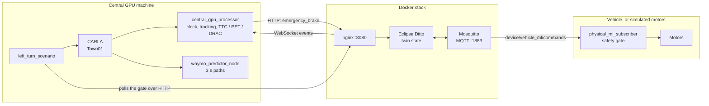

<div align="center">

# Smart Digital Twin of an Urban Intersection

**A CARLA and Eclipse Ditto simulation that watches an intersection from above, predicts where vehicles are going, and brakes a vehicle before a collision.**


*An unsafe left turn. The safety brake stops the orange car 0.29 m short of the oncoming blue car, then it finishes the turn.*

[What it does](#what-it-does) · [Run it](#run-it) · [Results](#left-turn-results) · [How it works](#how-it-works) · [Project status](#project-status) · [Limitations](#known-limitations)

</div>

---

## What it does

You can't stage near-collisions on a real road, so this project studies them in a digital twin of an intersection. It's a university capstone research project and a proof of concept, not for use on public roads.

Running it plays out one scenario in CARLA: a car turns left across oncoming traffic, once unsafely and once safely. While that happens, the system:

- **Tracks every vehicle** at `Town01_Intersection_01` from an overhead gantry, keeping each one's state in an Eclipse Ditto digital twin.
- **Predicts each vehicle's next 3 seconds**, following the road and using turn signals and turn rate to choose a branch (the red lines).
- **Scores the risk** with surrogate safety metrics: time-to-collision (TTC), post-encroachment time (PET) and deceleration rate to avoid a crash (DRAC).
- **Brakes the ML vehicle** when a collision is predicted, sending the command through Ditto and MQTT to a safety gate that cuts the motors. In the simulation those motors are simulated.
- **Reports the result**, comparing what happened with the same plan replayed with no brake.

| The car pulls out too soon | The brake stops it just short | It finishes the turn | The safe turn, for comparison |
| :---: | :---: | :---: | :---: |
|  |  |  |  |

Yellow boxes mark tracked vehicles, red lines are predicted paths, and the square marks the point where the two paths cross.

---

## Run it

### You'll need

- Windows with **Docker Desktop** (WSL2 backend)
- **Python 3.10**
- **CARLA 0.9.16** and a GPU that can run it. The client and server versions must match; see the [CARLA install guide](https://carla.readthedocs.io/en/latest/start_quickstart/)

### Install

```powershell
python -m venv .venv
.venv\Scripts\activate
pip install -r requirements.txt
pip install config\carla-0.9.16-cp310-cp310-win_amd64.whl
```

### Start everything with one command

```powershell
python run_simulation.py
```

This starts whatever isn't already running (Docker, the Ditto stack, CARLA), sets up the twins, runs the unsafe and safe left turns in the CARLA window, prints the comparison, then shuts down only what it started. A first CARLA launch can take several minutes.

| Option | What it does |
| ------ | ------------ |
| `--case unsafe` or `--case safe` | Runs just one |
| `--leave-running` | Keeps CARLA and Docker up, for faster repeat runs |
| `--carla-exe <path>` | Points at `CarlaUE4.exe`, if it isn't found automatically. Setting `CARLA_EXE` does the same |

The report and per-tick data go to `output/`, and logs go to `output/logs/`. Without trained models, the scripts use the stand-ins described under [Known limitations](#known-limitations) and say so at startup.

<details>
<summary><b>Run the pieces yourself</b></summary>

Run these from the repository root, each long-running one in its own terminal.

**1. Start the stack and set up the twins.** Wait 60 to 90 seconds for Ditto between these two commands. Re-running the second one resets the Things.

```powershell
docker compose -f docker/docker-compose.yml up -d
python scripts/setup_entities.py
```

**2. Start CARLA, then the processor.** It must come first, because it owns the simulation: it loads `Town01`, enables synchronous mode at 10 Hz and drives `world.tick()`. Wait for `Master tick running at 10 Hz`, and exit with Ctrl+C so it can restore CARLA's settings.

```powershell
python scripts/central_gpu_processor.py
```

**3. Start the safety gate.** `--driver sim` uses no motors. On a vehicle, use `--broker <central machine IP>`; it only needs `pip install paho-mqtt`.

```powershell
python scripts/physical_ml_subscriber.py --driver sim
```

**4. Start the predictor and run the scenario.**

```powershell
python scripts/waymo_predictor_node.py
python scripts/left_turn_scenario.py --case both
```

**To mirror your own vehicles instead of running the scenario,** start an agent for each Thing. Each one opens a chase-camera window and spawns a CARLA vehicle named after the Thing, which is how the processor recognises it. These twins hold still while the brake is on, and `human_vehicle` has no safety gate.

```powershell
python scripts/ditto_carla_agent.py
python scripts/ditto_carla_agent.py --thing human_vehicle
```

**The brake latches.** Outside the scenario, release it with:

```powershell
python scripts/setup_entities.py --clear-brake
```

**Shut down** with this. Add `-v` only if you want to wipe the Ditto data.

```powershell
docker compose -f docker/docker-compose.yml down
```

</details>

---

## Left-turn results

`vehicle_ml` waits to turn left across `human_vehicle`, which comes straight through at 10 m/s and never reacts. Both runs use the same paths and speeds and differ only in when the turning car goes: the unsafe one pulls out to arrive 1 s after the oncoming car, and the safe one waits to arrive 3 s after it.

| | Unsafe, no brake | Unsafe, with brake | Safe |
| - | :---: | :---: | :---: |
| **Verdict** | UNSAFE | UNSAFE | SAFE |
| **Contact** | yes | no | no |
| **Closest gap between cars** | 0.00 m | 0.29 m | 1.90 m |
| **Measured PET** | 0.30 s | 2.10 s | 2.30 s |
| **Brake fired** | no | at 6.6 s | no |

The "no brake" column replays the same plan in calculation, not in CARLA. The result was identical on all 4 runs checked.

A run is **UNSAFE** if the car outlines overlap or come within 1 m, TTC drops under 1.5 s, PET drops under 1.5 s, DRAC goes over 3.35 m/s², or the brake fires. In the scenario, once the oncoming car has passed, the script releases the brake as an operator would so the car can finish its turn. Nothing else auto-releases it.

### The brake doesn't catch everything

0.29 m is right at the edge of what the brake can handle. These runs varied only the turning car's arrival time:

| Arrives after the oncoming car | Brake | Result |
| :---: | :---: | ---- |
| 0.9 s | fires at 6.3 s | miss by 1.11 m |
| **1.0 s (the unsafe run above)** | **fires at 6.6 s** | **miss by 0.29 m** |
| 1.1 s | fires at 7.5 s, too late | **contact** |
| 1.2 s and 1.3 s | never fires | **contact** |
| 1.4 s | never fires | miss by 0.07 m |

The cause isn't confirmed. Likely factors are the 2.5 m collision circle being used on 4.8 m cars, and the prediction holding current speed while the car is accelerating.

---

## How it works

Each vehicle has a **digital twin** in Eclipse Ditto that holds its latest state. Anything that writes the same telemetry, a real robot or a test script, drives everything downstream the same way, so the vehicles are decoupled from the simulator.



**The brake fires** when straight-line TTC to `vehicle_ml` drops under 1.5 s, or when the vehicles' predicted paths meet within 3 s. The path check was added because straight-line TTC can't see a turn coming: in the left turn it only fired once the car was already crossing the lane, too late to prevent contact.

**The safety gate fails safe.** It holds the motors off before it receives its first state, whenever it loses the broker, and until it hears an explicit release.

| Thing | Role |
| ----- | ---- |
| `org.example:intersection_01` | The intersection; holds the latest `SafetyMetrics` |
| `org.example:vehicle_ml` | The ML vehicle; the only one with a `SafetyGate` |
| `org.example:human_vehicle` | The other vehicle |

<details>
<summary><b>Repository layout</b></summary>

```
run_simulation.py    Starts everything and runs the left-turn analysis
docker/              Ditto stack: docker-compose.yml, mosquitto.conf, nginx.conf
config/              Ditto policies, Things and connections, and the CARLA 0.9.16 client
models/              Where trained models go, and the contract they must meet
scripts/
  central_gpu_processor.py    Simulation clock, overhead sensors, fusion, metrics, brake trigger
  waymo_predictor_node.py     History buffer, 3 s path prediction, red lines
  physical_ml_subscriber.py   Safety gate that cuts the motors (runs on the vehicle)
  left_turn_scenario.py       Safe vs unsafe left turn, and its analysis
  setup_entities.py           Provisions Ditto from config/
  ditto_carla_agent.py        Mirrors one Thing into CARLA, with a chase camera
  test_carla_connection.py    CARLA connection check
  test_traffic.py             Spawns background traffic in CARLA
tests/               Unit tests and the end-to-end latency benchmark
hardware/            KUKSA to Ditto publisher, for physical vehicles
bridge/              Older standalone Ditto to CARLA sync
docs/images/         The pictures on this page
```

</details>

<details>
<summary><b>Ports and telemetry format</b></summary>

| Port | Service |
| ---- | ------- |
| 8080 | nginx, proxying the Ditto API and WebSocket. It injects the `x-ditto-pre-authenticated` header |
| 8081 | Ditto gateway, direct access |
| 1883 / 9001 | Mosquitto (MQTT / WebSocket) |
| 27017 | MongoDB (data is kept in the `mongo-data` volume) |

> **Warning:** Nothing here authenticates. Anyone who can reach 8080 can write to the twins, and anyone who can reach 1883 can publish telemetry or brake commands. Keep these ports on a trusted lab network.

Vehicles publish [Ditto Protocol](https://eclipse.dev/ditto/protocol-overview.html) JSON to `telemetry/<thing name>`. The processor reads `location` + `velocity` (m/s), or `kinematics` as written by `hardware/kuksa_to_ditto.py` (`x`, `y`, `heading` in degrees, `speed` in km/h). Poses must already be in the CARLA frame.

```json
{
  "topic": "org.example/human_vehicle/things/twin/commands/merge",
  "headers": { "content-type": "application/merge-patch+json", "response-required": false },
  "path": "/features",
  "value": {
    "location": { "properties": { "x": 12.0, "y": 4.5, "z": 0.0 } },
    "velocity": { "properties": { "vx": 1.5, "vy": 0.0 } }
  }
}
```

</details>

---

## Project status

| Area | State |
| ---- | ----- |
| Docker stack, Ditto twins, MQTT safety path | **Working**, tested live |
| One-command launcher | **Working** when CARLA and Docker are already up. Starting them itself isn't tested yet |
| Master tick, overhead view, on-screen overlays | **Working** in CARLA |
| Left-turn scenario and analysis | **Working**, for this one junction and these fixed speeds |
| Path prediction | **Road-following stand-in**. No Waymo model yet |
| Vehicle detection | **CARLA's true positions, as a stand-in.** The overhead LiDAR runs and its data is formatted for a model, but there's no model yet |
| Physical vehicles (Rosmaster R2, KUKSA) | **Written, not yet run on hardware.** The motor drivers and KUKSA publisher have never run |
| Lab-to-CARLA coordinate mapping, SkyEye view, Kafka logging, AI recommendations | **Not started** |

### Engineering targets

These are the targets from the project report, against what has been measured so far.

| Requirement | Target | Measured so far |
| ----------- | ------ | --------------- |
| End-to-end latency (REQ-SYS-002) | At most 100 ms, sensor to CARLA rendering | About 60 ms (p95) from Ditto write to simulated motor cut, on one machine. The sensor-to-rendering path isn't measured |
| Update rate (REQ-SYS-003) | At least 10 Hz (target 20 Hz) | 10.0 Hz simulation tick, at real-time speed |
| Safety metrics (REQ-SYS-011) | TTC and headway; flag TTC under 1.5 s | TTC, PET and DRAC done, and the 1.5 s flag works. Headway isn't implemented |
| Telemetry payload (REQ-SYS-001) | Full state vector, JSON over MQTT/HTTP | Position and velocity only |
| Position and heading accuracy (REQ-SYS-004, 005) | Within 5 cm and 2 degrees | Not measured; needs physical vehicles |
| Bird's-eye rendering (REQ-SYS-006, 007) | At least 30 FPS, at most 100 ms delay | Not measured |
| Scalability (REQ-SYS-008, 009) | 10 vehicles within 150 ms | Not measured |
| Logging (REQ-SYS-010) | 10 Hz, UTC timestamps at 1 ms precision | Scenario data only, in simulation time |

---

## Known limitations

- **The brake misses some collisions.** See [the table above](#the-brake-doesnt-catch-everything). All of this comes from one junction, with fixed speeds and an oncoming car that never reacts.
- **It relies on a turn signal.** The turning car signals in every run. An unsignalled turn is untested, and the brake will probably fire later.
- **The path check only works on CARLA actors.** Telemetry alone and model detections fall back to the 1.5 s TTC rule. That includes physical vehicles until lab positions are mapped into CARLA.
- **No trained models are in the repo.** A stock CenterPoint is unlikely to work from an overhead sensor. See [models/README.md](models/README.md).
- **The vehicle can't tell if the processor has died.** The gate fails safe if the broker link drops, but a crashed processor simply stops sending hazards.
- **A silent Wi-Fi drop took 3.8 s to detect** in testing, which is longer than the 1.5 s brake window. Lowering `MQTT_KEEPALIVE` shortens it.
- **Live PET is predicted.** The `SafetyMetrics` Thing holds PET extrapolated from current velocities. The scenario report's PET is measured after the fact.
- **`bridge/ditto_carla_sync.py` is out of date.** It still points at `org.ovin:my-vehicle` on `192.168.0.100`.

---

## Testing

```powershell
pytest
```

| Test file | Needs |
| --------- | ----- |
| `test_safety_logic.py`, `test_left_turn.py` | Nothing running |
| `test_agent_brake.py` | The `carla` and `pygame` packages; skips itself without them |
| `test_mqtt_pipeline.py` | The Docker stack, not CARLA. Skips itself when the stack is down, as on CI, and resets Thing state. Add `-s` to see the timings |

---

## Troubleshooting

<details>
<summary><b>The launcher fails, or a script dies during a run</b></summary>

Check `output/logs/`, which has a log for the processor, subscriber and predictor. A CARLA client aborting with `_episode != nullptr` was seen on a freshly started server; the launcher retries the processor once.

</details>

<details>
<summary><b>CARLA import or connection errors</b></summary>

The client and server versions must match. The wheel in `config/` is for CARLA 0.9.16 and Python 3.10 on Windows.

</details>

<details>
<summary><b>Other scripts conflict with the processor</b></summary>

Only one process may tick the world. `scripts/test_traffic.py` ticks unless you pass `--asynch`, and `scripts/test_carla_connection.py` always does, so stop the processor first or use `test_traffic.py --asynch`.

</details>

<details>
<summary><b>Ditto resets or won't answer on Windows</b></summary>

Use `localhost`, not `127.0.0.1`. Requests to `127.0.0.1:8080` were reset in our setup while `localhost` worked.

</details>

<details>
<summary><b>PATCH requests are rejected</b></summary>

Ditto only accepts `Content-Type: application/merge-patch+json` for PATCH. Plain `application/json` is rejected, so use PUT if you want to send plain JSON.

</details>

<details>
<summary><b>Ditto data disappeared</b></summary>

`down -v` deletes the `mongo-data` volume. Plain `down` keeps it.

</details>

---

### Acknowledgements

Built on [CARLA](https://carla.org/), [Eclipse Ditto](https://eclipse.dev/ditto/), [Eclipse KUKSA](https://eclipse.dev/kuksa/), and [Eclipse Mosquitto](https://mosquitto.org/).
